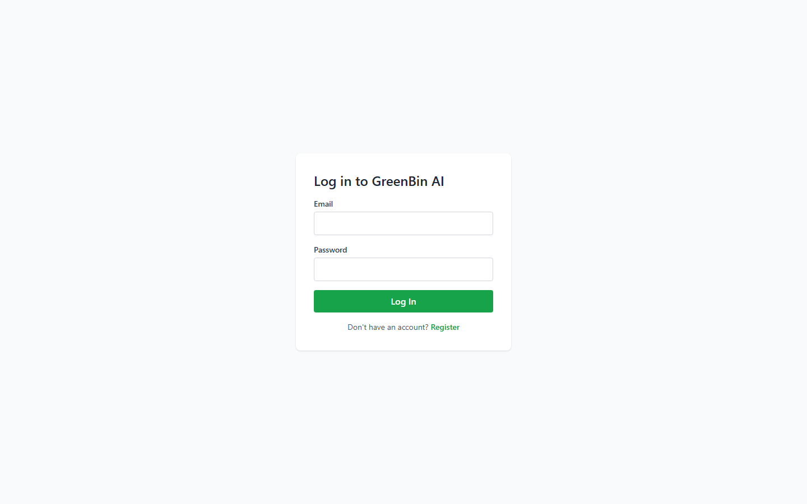
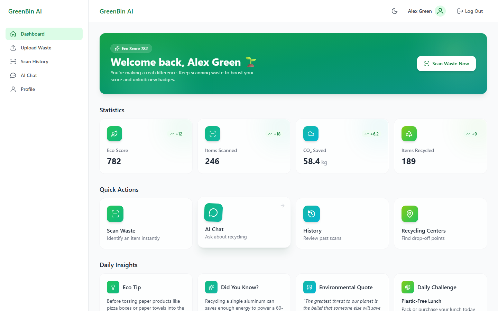
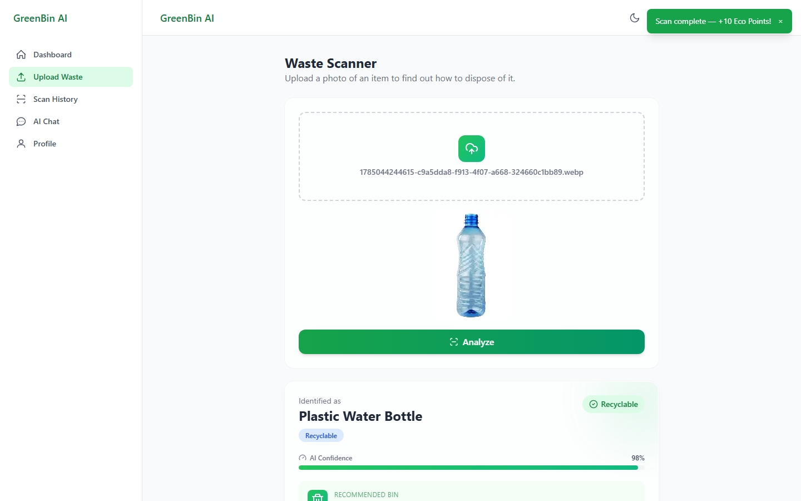
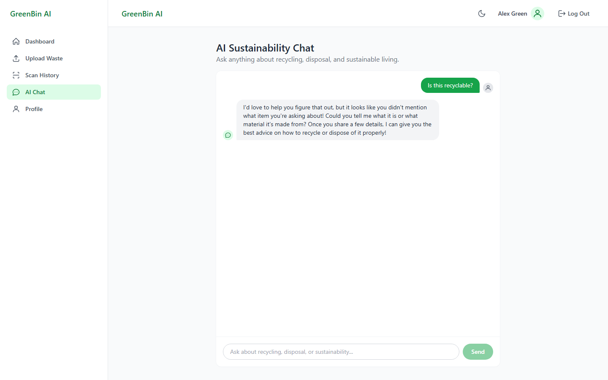
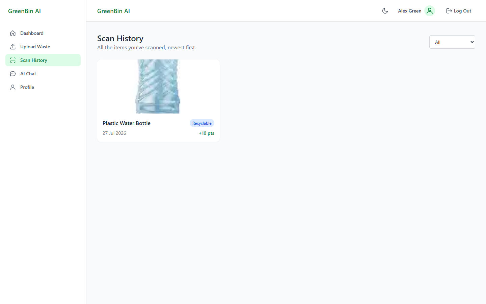
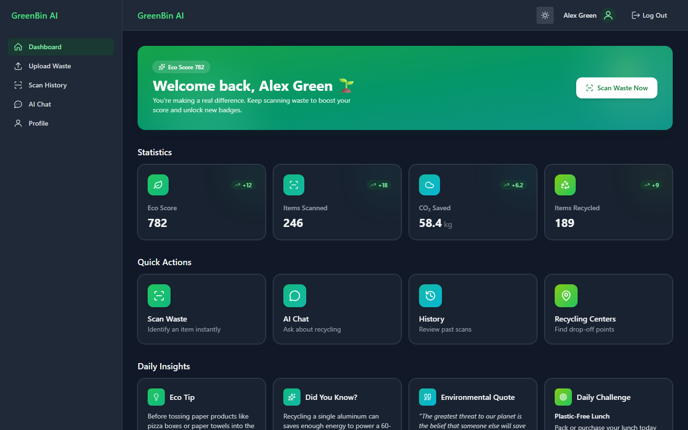

# GreenBin AI

GreenBin AI is a full-stack MERN application that uses Google's **Gemini API** to identify waste items from a photo, tells you how to dispose of them correctly, and gamifies recycling with an Eco Score, badges, and AI-generated daily sustainability content.

- **Frontend:** React 18 + Vite + Tailwind CSS + lucide-react
- **Backend:** Node.js + Express + MongoDB (Mongoose)
- **AI:** Google Gemini (`@google/generative-ai`) for waste image classification, a sustainability chatbot, and daily content generation

---

## Table of Contents

- [Features](#features)
- [Tech Stack](#tech-stack)
- [Screenshots](#screenshots)
- [Folder Structure](#folder-structure)
- [Getting Started](#getting-started)
- [Environment Variables](#environment-variables)
- [API Routes](#api-routes)
- [NPM Scripts](#npm-scripts)
- [Deployment](#deployment)

---

## Features

- **Authentication** — JWT-based register/login, protected routes, persisted session
- **Dashboard** — Welcome banner, Eco Score / Items Scanned / CO₂ Saved / Items Recycled stat cards, quick actions, recent activity, progress cards, and a Gemini-powered "Daily Insights" section (Eco Tip, Did You Know, Environmental Quote, Daily Challenge)
- **Waste Scanner** — Upload a photo of an item; Gemini identifies it and returns:
  - Waste Type (Recyclable / Organic / Hazardous / E-Waste / General Waste)
  - Confidence score
  - Recommended Bin
  - Description
  - Recyclable status
  - Environmental Impact
  - Eco Points awarded per scan
- **Scan History** — Browse past scans, filterable by waste type
- **AI Chat** — Conversational sustainability assistant backed by Gemini, with persisted chat history
- **Badges & Progress** — Tiered badges (Getting Started → Eco Legend) based on items recycled
- **Dark Mode** — Toggle, persisted to `localStorage`, respects system preference on first load
- **Responsive UI** — Mobile-friendly layout with a collapsible sidebar

## Tech Stack

| Layer | Technologies |
|---|---|
| Frontend | React 18, Vite 6, React Router 6, Tailwind CSS 3, Axios, lucide-react |
| Backend | Node.js, Express 4, Mongoose 8, JWT (`jsonwebtoken`), bcryptjs, Multer |
| Database | MongoDB (Atlas in production) |
| AI | Google Gemini (`@google/generative-ai`) |
| Deployment | MongoDB Atlas · Render (backend) · Vercel (frontend) |

## Screenshots

> Add screenshots to `frontend/src/assets/screenshots/` and update the paths below.

| Login | Dashboard |
|---|---|
|  |  |

| Waste Scanner Result | AI Chat |
|---|---|
|  |  |

| Scan History | Dark Mode |
|---|---|
|  |  |

## Folder Structure

```
GreenBinAI/
├── DEPLOYMENT.md              # Detailed step-by-step deployment guide
├── README.md
│
├── backend/
│   ├── config/
│   │   ├── env.js             # Loads .env before anything else reads process.env
│   │   └── db.js              # MongoDB connection
│   ├── controllers/
│   │   ├── authController.js      # register, login, getMe
│   │   ├── scanController.js      # analyzeScan, getScanHistory, getScanStats
│   │   ├── chatController.js      # getChatHistory, sendChatMessage
│   │   └── insightsController.js  # ecoTip, didYouKnow, environmentalQuote, dailyChallenge
│   ├── middleware/
│   │   ├── authMiddleware.js   # protect (JWT verification)
│   │   ├── uploadMiddleware.js # Multer image upload (memory storage, 5MB limit)
│   │   ├── errorHandler.js     # Centralized error handler
│   │   └── notFound.js         # 404 handler for /api/*
│   ├── models/
│   │   ├── User.js
│   │   ├── Scan.js
│   │   └── Chat.js
│   ├── routes/
│   │   ├── authRoutes.js
│   │   ├── scanRoutes.js
│   │   ├── chatRoutes.js
│   │   └── insightsRoutes.js
│   ├── services/
│   │   └── insightsService.js  # Gemini prompts + 1-hour in-memory cache per insight
│   ├── utils/
│   │   ├── geminiClient.js     # Gemini client, waste analysis + chat + generic JSON generation
│   │   ├── cache.js            # withCache(key, ttlMs, fetcher) in-memory TTL cache
│   │   ├── badges.js           # Badge tiers + progress calculation
│   │   └── generateToken.js    # JWT signing
│   ├── uploads/                # Uploaded scan images (gitignored, ephemeral in production)
│   ├── server.js                # App entry point
│   ├── .env.example
│   └── package.json
│
└── frontend/
    ├── public/
    ├── src/
    │   ├── assets/
    │   ├── components/
    │   │   ├── dashboard/           # Dashboard-only components
    │   │   │   ├── WelcomeBanner.jsx
    │   │   │   ├── DashboardStatCard.jsx
    │   │   │   ├── QuickActionCard.jsx
    │   │   │   ├── RecentActivity.jsx
    │   │   │   ├── ProgressCard.jsx
    │   │   │   └── InsightCard.jsx  # Loading / error+retry / content states
    │   │   ├── DashboardLayout.jsx  # Sidebar + Navbar shell for authenticated pages
    │   │   ├── Navbar.jsx
    │   │   ├── Sidebar.jsx
    │   │   ├── ProtectedRoute.jsx
    │   │   ├── ScanResultCard.jsx   # Waste Scanner result display
    │   │   ├── ScanHistoryCard.jsx
    │   │   ├── PageLoader.jsx / Spinner.jsx / ToastContainer.jsx / TypingIndicator.jsx / ErrorBoundary.jsx
    │   │   └── icons.jsx            # Hand-rolled SVG icon set (nav/UI chrome)
    │   ├── context/
    │   │   ├── AuthContext.jsx
    │   │   ├── ThemeContext.jsx
    │   │   └── ToastContext.jsx
    │   ├── data/
    │   │   └── mockDashboardData.js # Mock stats/activity/progress for the Dashboard UI
    │   ├── hooks/
    │   │   ├── useAuth.js / useTheme.js / useToast.js
    │   ├── pages/
    │   │   ├── Login.jsx / Register.jsx
    │   │   ├── Dashboard.jsx
    │   │   ├── WasteScanner.jsx
    │   │   ├── ScanHistory.jsx
    │   │   ├── AIChat.jsx
    │   │   ├── ComingSoon.jsx / NotFound.jsx
    │   ├── services/                # Axios calls, one module per API resource
    │   │   ├── api.js               # Axios instance, auth header + 401 interceptors
    │   │   ├── authService.js
    │   │   ├── scanService.js
    │   │   ├── chatService.js
    │   │   └── insightsService.js
    │   ├── App.jsx                  # Route definitions
    │   ├── main.jsx                 # Providers + app mount
    │   └── index.css
    ├── .env.example
    ├── vite.config.js               # Dev proxy: /api and /uploads → localhost:5000
    ├── tailwind.config.js
    └── package.json
```

## Getting Started

### Prerequisites

- [Node.js](https://nodejs.org/) 18+ and npm
- A [MongoDB](https://www.mongodb.com/cloud/atlas) connection string (Atlas free tier works)
- A [Gemini API key](https://aistudio.google.com/apikey) (Google AI Studio)

### 1. Clone the repository

```bash
git clone <repository-url>
cd GreenBinAI
```

### 2. Backend setup

```bash
cd backend
npm install
cp .env.example .env
```

Fill in `backend/.env`:

```
NODE_ENV=development
PORT=5000
MONGO_URI=your_mongodb_atlas_connection_string
JWT_SECRET=your_jwt_secret
JWT_EXPIRES_IN=7d
GEMINI_API_KEY=your_google_gemini_api_key
GEMINI_MODEL=gemini-flash-latest
CLIENT_URL=*
```

Start the API (runs on `http://localhost:5000`):

```bash
npm run dev
```

### 3. Frontend setup

In a second terminal:

```bash
cd frontend
npm install
npm run dev
```

The app runs at `http://localhost:5173`. In development, no frontend `.env` is needed — Vite proxies `/api` and `/uploads` to `http://localhost:5000` (see `vite.config.js`).

### 4. Use the app

Open `http://localhost:5173`, register a new account, and start scanning.

## Environment Variables

**Backend** (`backend/.env`, copy from `backend/.env.example`):

| Variable | Required | Default | Notes |
|---|---|---|---|
| `NODE_ENV` | recommended | — | `development` locally, `production` when deployed |
| `PORT` | no | `5000` | Render/hosts set this automatically |
| `MONGO_URI` | yes | — | MongoDB connection string |
| `JWT_SECRET` | yes | — | Any long random string |
| `JWT_EXPIRES_IN` | no | `7d` | JWT expiry |
| `GEMINI_API_KEY` | yes | — | From Google AI Studio |
| `GEMINI_MODEL` | no | `gemini-flash-latest` | Gemini model name |
| `CLIENT_URL` | recommended | `*` | Exact frontend origin in production, for CORS |

**Frontend** (`frontend/.env`, copy from `frontend/.env.example`):

| Variable | Required | Notes |
|---|---|---|
| `VITE_API_BASE_URL` | only in production | Deployed backend URL + `/api`. Leave unset locally — Vite proxies instead. |

## API Routes

All routes are prefixed with `/api`. Routes marked **Auth** require an `Authorization: Bearer <token>` header.

| Method | Path | Auth | Description |
|---|---|:---:|---|
| GET | `/api/health` | | Health check — `{ status: 'ok', service: 'GreenBin AI backend' }` |
| POST | `/api/auth/register` | | Register a new user — body: `{ name, email, password }` |
| POST | `/api/auth/login` | | Log in — body: `{ email, password }` |
| GET | `/api/auth/me` | ✅ | Get the current authenticated user |
| POST | `/api/scans/analyze` | ✅ | Upload an image (`multipart/form-data`, field `image`) — Gemini analyzes it and the scan is saved |
| GET | `/api/scans` | ✅ | List the current user's scan history — optional `?category=` query filter |
| GET | `/api/scans/stats` | ✅ | Eco Score, items recycled, badges, and progress-to-next-badge |
| GET | `/api/chat` | ✅ | Get the current user's chat history |
| POST | `/api/chat` | ✅ | Send a message — body: `{ message }` — returns the Gemini reply |
| GET | `/api/insights/eco-tip` | ✅ | AI-generated eco tip (cached 1 hour) |
| GET | `/api/insights/did-you-know` | ✅ | AI-generated "did you know" fact (cached 1 hour) |
| GET | `/api/insights/quote` | ✅ | AI-generated environmental quote (cached 1 hour) |
| GET | `/api/insights/daily-challenge` | ✅ | AI-generated daily challenge (cached 1 hour) |

### `POST /api/scans/analyze` response shape

```json
{
  "_id": "...",
  "user": "...",
  "imageUrl": "/uploads/....webp",
  "itemName": "Plastic Water Bottle",
  "wasteType": "Recyclable",
  "confidence": 98,
  "recommendedBin": "Blue Recycling Bin",
  "description": "A clear plastic bottle made from PET plastic...",
  "recyclable": true,
  "environmentalImpact": "Recycling plastic bottles reduces fossil fuel consumption...",
  "points": 10,
  "createdAt": "...",
  "updatedAt": "..."
}
```

## NPM Scripts

**Backend** (`backend/package.json`):

| Script | Description |
|---|---|
| `npm start` | Run the server with `node` |
| `npm run dev` | Run the server with `nodemon` (auto-restart on file changes) |

**Frontend** (`frontend/package.json`):

| Script | Description |
|---|---|
| `npm run dev` | Start the Vite dev server |
| `npm run build` | Production build to `frontend/dist` |
| `npm run preview` | Preview the production build locally |
| `npm run lint` | Run ESLint |

## Deployment

Full step-by-step instructions (MongoDB Atlas → Render → Vercel, including CORS lock-down and a post-deploy checklist) live in **[DEPLOYMENT.md](DEPLOYMENT.md)**.

Quick summary:

1. **Database:** Create a free MongoDB Atlas cluster, allow network access from anywhere, and copy the connection string.
2. **Backend:** Deploy `backend/` to [Render](https://render.com) as a Node web service (`npm install` / `npm start`), setting the environment variables listed above.
3. **Frontend:** Deploy `frontend/` to [Vercel](https://vercel.com) (Vite preset), setting `VITE_API_BASE_URL` to the Render backend URL + `/api`.
4. **CORS:** Set `CLIENT_URL` on Render to the deployed Vercel URL.

> **Known limitation:** uploaded scan images are stored on local disk (`backend/uploads/`) and are lost on redeploy/restart on Render's free tier (ephemeral filesystem). Scan text data in MongoDB is unaffected. See `DEPLOYMENT.md` for the fix (swap to Cloudinary/S3).
